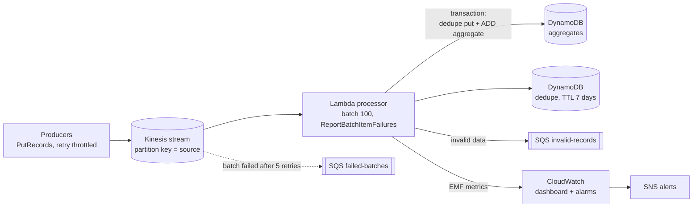

# CloudStream

A serverless real-time event pipeline on AWS: producers write events to **Kinesis**, a
**Lambda** function validates them and keeps per-minute aggregates in **DynamoDB**, and
**CloudWatch** tracks throughput, lag and bad data with alarms. Every event is counted
exactly once, even when Lambda retries a batch or a producer sends a duplicate.

## Architecture



## How it handles failure

| Situation | What happens |
|---|---|
| Malformed record (bad JSON, missing fields, non-numeric value, timestamp in the future or older than 7 days) | Sent to the `invalid-records` queue with the reason; processing continues. Retrying bad data would never succeed. |
| DynamoDB throttling or a timeout on one record | The handler returns that record's sequence number in `batchItemFailures` and stops. Lambda retries from that record; earlier records stay committed. |
| The same event arrives twice (producer retry, Lambda replay) | Each event is written in one DynamoDB transaction: a conditional put of `event_id` into the dedupe table **and** an atomic `ADD` on the aggregate. If the `event_id` exists, the whole transaction is cancelled and the event is counted as a duplicate, not added again. |
| A batch keeps failing | After 5 retries (with batch bisection to isolate the bad record) the batch metadata goes to the `failed-batches` queue and an alarm fires. |
| Producer throttled by Kinesis | `PutRecords` responses are checked per entry and only failed entries are re-sent, with exponential backoff. |

## Data model

**aggregates** (`series` = `source_id#event_type`, `minute` = `YYYY-MM-DDTHH:MM`):
`event_count`, `value_sum`, `updated_at`; the average is computed at read time.
Querying one sensor's last hour is a single `Query` on the partition key.

**dedupe** (`event_id`): `expires_at` TTL of 7 days, matching the oldest event the
processor accepts, so the table stays small.

## Observability

The handler writes metrics in CloudWatch Embedded Metric Format, which costs no API calls:
`RecordsReceived`, `AppliedRecords`, `DuplicateRecords`, `InvalidRecords`,
`RetriedRecords`, `BatchProcessingMs` and `MaxRecordAgeMs`. The stack creates a
dashboard and alarms for iterator age above 60 s, function errors, a spike in invalid
records, and anything in the failed-batches queue.

## Tech stack

Python 3.12, AWS Lambda, Amazon Kinesis Data Streams, Amazon DynamoDB, Amazon SQS,
Amazon CloudWatch (EMF, alarms, dashboard), SNS, AWS SAM / CloudFormation, boto3,
moto, pytest, cfn-lint, GitHub Actions.

## Run it locally (no AWS account)

```bash
git clone https://github.com/Nickbhalala/CloudStream.git && cd CloudStream
python -m venv .venv && source .venv/bin/activate
pip install -e ".[dev]"

cloudstream-simulate --events 2000 --duplicates 50 --bad 10
pytest
```

`cloudstream-simulate` uses [moto](https://github.com/getmoto/moto) to stand in for
Kinesis, DynamoDB and SQS in-process. It produces events (plus re-sent duplicates and
malformed records), reads them back from the stream in Lambda's event format, runs the
real handler and prints the metrics, for example:

```text
metrics: {'AppliedRecords': 2000, 'DuplicateRecords': 50, 'InvalidRecords': 10, 'RecordsReceived': 2060}
dead-lettered: 10
```

The tests cover validation rules, exactly-once writes, the retry/partial-failure path
(a store that fails mid-batch, then a full replay that adds nothing twice), the
producer's retry logic, and `cfn-lint` on the template.

## Deploy to AWS

Requires the [AWS SAM CLI](https://docs.aws.amazon.com/serverless-application-model/)
and credentials for your account (`aws sso login` or a profile). This creates billable
resources (a Kinesis shard is charged per hour).

```bash
sam build
sam deploy --guided --stack-name cloudstream          # optionally set AlarmEmail

export AWS_REGION=us-east-1
cloudstream-produce --stream cloudstream-events --count 5000
cloudstream-query sensor-001 temperature --minutes 15
```

Remove everything with `sam delete --stack-name cloudstream`.

## Configuration

| Setting | Where | Default |
|---|---|---|
| `ShardCount`, `BatchSize`, `AlarmEmail` | template parameters | 1, 100, none |
| `AGGREGATES_TABLE`, `DEDUPE_TABLE`, `DLQ_URL` | Lambda environment (set by the template) | |
| `CLOUDSTREAM_STREAM`, `CLOUDSTREAM_AGG_TABLE` | producer/query scripts, see `.env.example` | stack names |

## Project structure

```text
cloudstream/
  handler.py     Lambda entry point: validate, write, dead-letter, partial failures
  store.py       DynamoDB transactional exactly-once writes and queries
  events.py      event schema and validation
  metrics.py     CloudWatch Embedded Metric Format
  producer.py    Kinesis PutRecords with per-entry retry
  query.py       read aggregates for a sensor
  simulate.py    full local run on moto
  aws_local.py   creates tables/stream/queue like the template, reads stream as Lambda events
template.yaml    SAM: stream, tables, queues, function, alarms, dashboard
tests/
```

## What I'd improve next

- Batch several events per transaction (up to DynamoDB's 100-item limit) to cut write
  cost at high volume, falling back to single-event transactions on conflicts.
- Late-arriving data policy and a Kinesis Data Firehose branch to S3 for replay and
  analytics in Athena.
- Load test with a few thousand events per second to size shards and batch settings,
  with the results committed alongside the test script.
- Integration tests against a real AWS account in a separate CI workflow using OIDC.

## About this project

Built by Nikhil Bhalala with AI assistance (Claude by Anthropic) for code generation and
review.

## License

[MIT](LICENSE)
